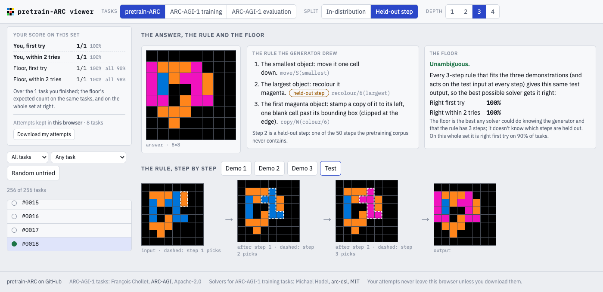
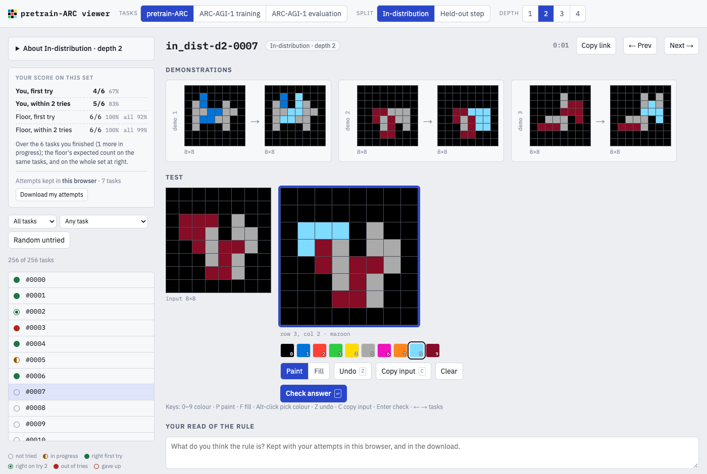

# pre-ARC

A large dataset of ARC-like tasks drawn from a deterministic rule generator.

We provide a pretraining corpus which is effectively unlimited in size, a fixed test set of 2,560 tasks that measures what
transfers out of pretraining, and, for every test task, the exact expected score of the best possible solver.

**[Open the viewer](https://jagilley.github.io/pre-arc/)** to solve the tasks yourself, see each one's rule
step by step, and compare them with ARC-AGI-1.



## Why

ARC-AGI-1 gives you 400 training tasks with three or so demonstrations each. That is far too little to train a
learner on, so every learning approach to ARC brings its own pretraining corpus (hand-written generators for the
training tasks, LLM-written puzzle programs, samples from a DSL) and hopes that what it learns there transfers to the
evaluation set. The corpus is then the variable that matters most, and it is the one nobody controls: each paper uses
its own, and how its contents relate to the test is unknown, so a score mixes up what the learner can do with what
its corpus happened to contain.

pre-ARC is that setup with the corpus made known. The corpus and the benchmark come from one generator whose
grammar is written down, so the relationship between them is exact:

- The **in-distribution** split is drawn from exactly the corpus's distribution, on grids the corpus never emits. It
  measures whether a learner picked up the grammar it was shown.
- The **held-out** split puts one step the corpus never contains into each rule. Every held-out step pairs a selector
  and an operator that the corpus does use, just never together ("flip the largest object upside-down" is held out;
  "flip the largest object left-right" and "flip the smallest object upside-down" are in the corpus). It measures
  whether what was learned composes.
- Both splits come at **depths 1-4**, the number of steps in a rule, so you can see where composition stops.

A score mixes in one more thing besides the corpus, which is how much the task's own demonstrations left open. Three
demonstrations often fit several rules that disagree on the test input. Suppose "recolour the smallest object red" and
"recolour the first object in reading order red" pick the same object in all three demonstrations and different
objects in the test input. The demonstrations cannot say which rule was meant, and the best anyone can do is bet on
the more likely one.

Because the generator is written down, "more likely" has an exact value. Each step is drawn uniformly among the steps
that act on all four grids, so the probability of any rule is a product of simple fractions, and one can list every
rule that reproduces the three demonstrations, weight each by its probability, and add up the weight behind each
candidate test output. The best possible solver answers with the output that has the most weight behind it, and its
expected error is one minus that output's share. That is the task's **Bayes floor**. It ships with every benchmark
task, at one, two and four attempts, and no solver can go below it in expectation, because the error it describes
belongs to the task rather than to the solver. A learner's score is then read against that solver's rather than
against 100%, and what it measures is how much of what the demonstrations determine the learner recovered.

The world is deliberately narrow: 8×8 grids, objects as connected components, five families of operator. Some of that
narrowness is the price of the floor, which is exact only because every rule the generator can draw can be listed.
This is a place to study how a pretraining corpus transfers, under control, rather than a replacement for ARC.

## The world

A task is three demonstration pairs and a test input, as in ARC. Each grid holds 4 or 5 objects: polyominoes of 2-6
cells, all of different sizes, in three colours, inside a one-cell border. Each object is exactly one 4-connected
single-colour component. The objects are nested into each other's bounding boxes and every colour is on at least two
of them, so no object can be picked out by its colour alone or by its bounding box alone.

A **rule** is 1 to 4 **steps** applied in order, and a step is a selector paired with an operator:

| selectors (13) | operators (20) |
|---|---|
| the largest object | recolour it (to any of 9 colours) |
| the smallest object | delete it |
| the first object in reading order | move it one cell (up, down, left, right) |
| the last object in reading order | flip it inside its bounding box (left-right, upside-down) |
| the first object of colour *c* (9 colours) | stamp a copy of it one blank cell past its bounding box (up, down, left, right) |

That makes 13 × 20 = 260 pairs, less the 9 that recolour an object to its own colour: **251 steps**. Objects are
recomputed after every step, so a step can merge or split them for the next one. A task's rule is drawn on the task's
own grids, uniformly among the steps that act on every one of them (select something and change it), so every step
of every task is visible in every pair. That is also what makes the floor exact. [`generator.py`](pre_arc/generator.py)
has the details; the code is short and numpy-only.

## The floor

The floor is computed exactly. The rule draw above fixes a rule's prior probability: the product, over its steps, of
one over the number of steps that were admissible at that position. [`floors.py`](pre_arc/floors.py) searches
every rule of the task's depth over the joint state of the four grids, merging rules that leave all four grids
identical, since those share every continuation, and keeping the ones that reproduce the three demonstrations. One
prune makes depth 4 tractable and loses nothing: at the last step a state is expanded only if each demonstration grid
can still reach its output in one step, and a step changes at most twice the selected object's cells, so that is quick
to check. Depth 4 visits about 100,000 joint states and takes tens of seconds a task on one core. The solver this
describes knows the generator and the rule's depth, and is not told which steps are held out.

The floors also say something about the format before any learner is involved. Three demonstrations fix a single test
output for 96% of depth-1 tasks and 59% of depth-4 tasks, and where they leave several, the probability concentrates
on a few, so four attempts bring the floor under 0.02 at every depth. Nor is the shipped answer always the one the
demonstrations make most probable. At depth 4 it is for 83% of tasks. The metadata marks the rest, and on those a
learner that answers "wrongly" is answering as the demonstrations say it should.

## The corpus

The corpus is a stream of tasks whose rules use only the 201 training steps. Any task in it is addressed by
(seed, shard, depth, index) and drawn from its own random generator, so any slice can be produced independently, on
any number of processes, and is the same every time.

How big it is, naively:

- **Very.** Step sequences over the training steps number 201 at depth 1, 40,401 at depth 2, 8.1 million at
  depth 3 and 1.6 billion at depth 4. On any one task's grids, 50 to 60 of the 201 steps act at each position, so a
  depth-4 task's rule is one draw from about 10 million that fit its grids. Grids rarely repeat: 100,000 draws held
  13 repeats, which puts the effective number of distinct grids at around 400 million.
- **Fast.** One CPU core writes about 120 depth-1 and 60 depth-4 tasks a second, so a million tasks is a few
  core-hours.
- **Small per task.** A task with one test pair is eight 8×8 grids, 512 cells.

For scale, ARC-AGI-1's 400 training tasks hold about 1,300 demonstration pairs.

```bash
pip install -e .        # editable: the benchmark files live beside the package, in benchmark/
python -m pre_arc corpus --out corpus/ --shards 0-99 --per-depth 256   # 102,400 tasks, JSONL, ARC's format
```

```python
from pre_arc import corpus, generator

t = corpus.corpus_task(seed=0, shard=0, depth=2, i=0)      # dict of numpy arrays: demo_in (3, 8, 8), demo_out, test_in, test_out
print(generator.rule_code(t["rule"]))                        # recolour/1(smallest) ; move/N(smallest)
for t in corpus.stream(seed=0, depths=(1, 2, 3, 4)):         # forever, 256 tasks of each depth a shard
    ...
```

`extra=n` adds n more input/output pairs of the same rule to each task. The corpus never emits a grid that appears in
the benchmark.

## The benchmark

| split | depth 1 | depth 2 | depth 3 | depth 4 |
|---|---|---|---|---|
| `in_dist` (every step a training step) | 512 | 256 | 256 | 256 |
| `held_out` (exactly one held-out step) | 512 | 256 | 256 | 256 |

It ships in [`benchmark/`](benchmark/) in the ARC Prize's Kaggle layout: `challenges.json` (the demonstrations and the
test input), `solutions.json` (the test output) and `metadata.json` (the rule in codes and words, which step is held
out, the floor at 1, 2 and 4 attempts, and whether the shipped answer is the one the demonstrations make most
probable). Task ids look like `held_out-d3-0042`. The package regenerates every task bit for bit (`pytest` checks this
against the fingerprint `5d9f992ce03cdced`).

Score a submission (Kaggle's `{task id: [{"attempt_1": grid, "attempt_2": grid}]}`) with

```bash
python -m pre_arc score submission.json
```

which reports pass@1, pass@2 (the ARC Prize's measure) and pass@4 by split and depth, next to `bayes@k`, the best
possible solver's expected score (1 minus the floor). Here are that solver and two baselines, as pass@1 / pass@2:

| split | depth | best possible | `one_step` | `identity` |
|---|---|---|---|---|
| `in_dist` | 1 | 0.98 / 1.00 | 0.98 / 1.00 | 0.00 / 0.00 |
| `in_dist` | 2 | 0.92 / 0.99 | 0.07 / 0.07 | 0.02 / 0.02 |
| `in_dist` | 3 | 0.90 / 0.98 | 0.03 / 0.03 | 0.01 / 0.01 |
| `in_dist` | 4 | 0.86 / 0.96 | 0.00 / 0.00 | 0.00 / 0.00 |
| `held_out` | 1 | 0.98 / 1.00 | 0.97 / 1.00 | 0.00 / 0.00 |
| `held_out` | 2 | 0.92 / 0.99 | 0.08 / 0.09 | 0.02 / 0.02 |
| `held_out` | 3 | 0.90 / 0.98 | 0.01 / 0.01 | 0.00 / 0.00 |
| `held_out` | 4 | 0.82 / 0.95 | 0.00 / 0.00 | 0.00 / 0.00 |

The best-possible column is the one to read a learner against. At held-out depth 4 it is 0.82 on one attempt, so a
learner at 0.80 there has recovered nearly everything the demonstrations determine, where against 100% it would look
to be missing a fifth. The same goes for comparing the splits. Held-out tasks are slightly more ambiguous than
in-distribution ones, so a raw gap between them mixes the tasks' extra ambiguity with the learner's failure to
compose. Subtract each split's floor from its score and what remains is about the learner.

`one_step` searches all 251 steps for the ones that act on the four inputs and reproduce the three demonstrations,
and answers with the outputs most of them agree on. At depth 1 that is exactly the best possible solver; from depth 2
on, a single step almost never explains a task. `identity` answers the test input unchanged. Every step changes the
grid it acts on, so it only scores when two steps happen to undo each other (move up, then move down). A third
baseline, `colour_map`, learns one colour substitution from the demonstrations and scores exactly what `identity`
does: every colour is on at least two objects and a step changes one of them, so no substitution ever fits.
`python -m pre_arc baselines` reproduces all three.

## The viewer

[jagilley.github.io/pre-arc](https://jagilley.github.io/pre-arc/) serves every benchmark task and all 800
ARC-AGI-1 tasks in one workbench. You paint an answer, get two tries, and then see the rule, the generator's trace on
every input, and the floor. Your attempts stay in your browser, and you can download them. Every task has its own
link.



## Reproducing

```bash
pip install -e ".[test]" && pytest -q        # the package rebuilds the benchmark exactly; under a minute
python scripts/export_benchmark.py           # rebuild benchmark/, floors included (4-7 CPU-hours, resumable)
python scripts/build_site.py                 # the viewer's data, into site/data/
python -m pre_arc show held_out-d2-0007      # one task in the terminal
```

| path | what it is |
|---|---|
| `pre_arc/generator.py` | grids, objects, steps, rules, and the rule draw |
| `pre_arc/floors.py` | the exact Bayes floor |
| `pre_arc/benchmark.py` | the held-out steps, the benchmark and its files |
| `pre_arc/corpus.py` | the corpus |
| `pre_arc/score.py` | scoring and the baselines |
| `benchmark/` | the 2,560 tasks, their solutions and metadata |
| `site/` | the viewer (`scripts/build_site.py` writes its data) |

## Credits

MIT licensed. The viewer shows [ARC-AGI-1](https://github.com/fchollet/ARC-AGI) (François Chollet, Apache-2.0) and,
for its training tasks, the hand-written solvers from Michael Hodel's
[arc-dsl](https://github.com/michaelhodel/arc-dsl) (MIT). Both are fetched at pinned commits when the site is built,
and the site serves their licence texts beside them.
